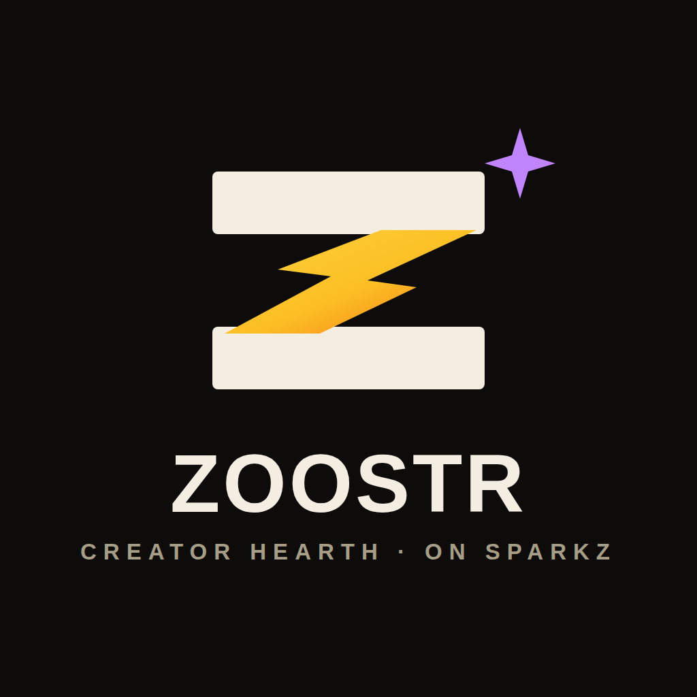

# Zoostr logo — the Z-Spark

Logo entry for Zoostr, the Creator Hearth on Sparkz, for poidh bounty
[#1568](https://poidh.xyz/base/bounty/1568).

## The idea

Zoostr starts with a Z, and a Hearth grows with Sparks — so the mark is a
**Z whose diagonal is a lightning bolt**:

- Two bone-white bars form the top and bottom of the Z.
- The diagonal is a single amber bolt (Sparkz amber `#FBBF24` → hearth-fire
  orange `#F97316`): the Spark that grows the Hearth.
- One purple spark star (`#C084FC`, the other Sparkz brand colour) sits at
  the top-right terminal — the first spark the hearth gives off.

Flat geometry, no effects: it reads at favicon size and at billboard size,
and it is built to sit on dark backgrounds, per the brief.

## Files

| File | What |
| --- | --- |
| `zoostr-logo.svg` | Full lockup (mark + wordmark), pure vector |
| `zoostr-logo-1024.png` | The same lockup, square 1024×1024 PNG |
| `zoostr-mark.svg` | Mark only, pure vector |
| `zoostr-mark-1024.png` | Mark only, square 1024×1024 PNG |

## Colours

- Background `#0D0C0A` (warm near-black)
- Bone `#F4EEE2`
- Amber gradient `#FFD23E` → `#FBBF24` → `#F97316`
- Spark purple `#C084FC`
- Muted subline `#A79E88`

## Note

Original work by @hdr, designed with help from an AI agent (stated openly,
as the bounty rules ask). Zoostr and Sparkz may use this submission freely,
per the bounty terms.
