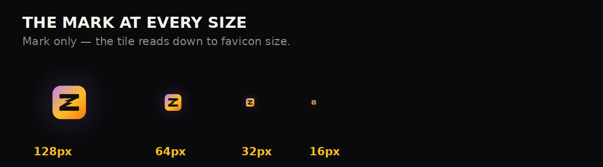
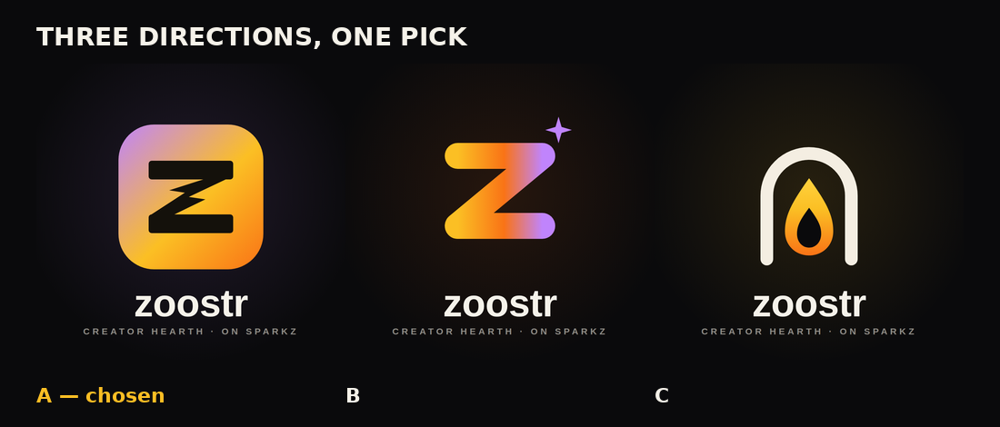

# Zoostr logo — gradient squircle, Z-bolt cut

Logo entry for Zoostr, the Creator Hearth on Sparkz, for poidh bounty
[#1568](https://poidh.xyz/base/bounty/1568) — pool 0.0127 ETH, judged by
funder vote after the deadline (Mon 30 Nov 2026, 11:59 WIB).

## The idea

An app-icon squircle filled with Sparkz's own gradient — purple `#C084FC`
→ amber `#FBBF24` → hearth orange `#F97316` — with a dark **Z cut through
it**. The Z's diagonal is a lightning bolt: the Spark that grows the
Hearth. A lowercase `zoostr` wordmark sits under the tile, with the
subline `CREATOR HEARTH · ON SPARKZ`.

Flat vector geometry, no effects. It is built to sit on dark backgrounds,
per the brief — the lockup and the mark both carry their own `#0A0A0C`
field, so they drop onto any dark surface without a bounding box showing.

## The mark at every size

The tile is the working part of the identity: app icon, favicon, avatar.
It holds its shape all the way down — the Z-bolt stays readable at 16 px,
where most wordmarks have already given up.

Rule of thumb: **mark alone below ~64 px** (icon, favicon, avatar);
**full lockup at 128 px and up** (headers, splash, social).

## Three directions, one pick

Three lockups were drawn from the same palette; the squircle + Z-bolt
(**A**) was picked — it is the only one that reads as both an app icon
and a hearth: the tile is the hearth, the bolt is the spark inside it.

- **A — chosen.** Gradient squircle, Z-bolt cut. The submission.
- **B.** Bare gradient Z with a spark star. Livelier, but the Z loses
  its frame at small sizes and the star vanishes below 32 px.
- **C.** Hearth arch + flame. Closest to the "hearth" word, but it reads
  as a fireplace, not as Zoostr — and the flame's inner counter closes
  up small.

## Files

| File | What |
| --- | --- |
| `zoostr-logo.svg` | Full lockup (tile + wordmark), pure vector |
| `zoostr-logo-1024.png` | The same lockup, square 1024×1024 PNG |
| `zoostr-logo-2048.png` | Full lockup, square 2048×2048 PNG |
| `zoostr-logo-fhd.svg` / `zoostr-logo-fhd.png` | Full lockup, 1920×1080 |
| `zoostr-mark.svg` | Tile mark only, pure vector |
| `zoostr-mark-1024.png` | Tile mark only, square 1024×1024 PNG |
| `variant-a.svg` / `variant-a.png` | Direction A — the chosen lockup |
| `variant-b.svg` / `variant-b.png` | Direction B — gradient Z + spark |
| `variant-c.svg` / `variant-c.png` | Direction C — hearth arch + flame |
| `preview-sizes.png` | Mark at 128 / 64 / 32 / 16 px |
| `preview-variants.png` | The three directions side by side |

## Colours

- Background `#0A0A0C`
- Gradient `#C084FC` → `#FBBF24` → `#F97316`
- Z knockout `#14110B`
- Wordmark `#F5F2EA`, subline `#8E8B85`

## Usage

- Keep the gradient as drawn — don't recolour the tile, and don't put
  the lockup on a light background (it is designed dark-first).
- Don't stretch, outline, or add effects to the mark; scale the SVG.
- Clear space: at least the height of the Z's top bar on all sides.

## Note

Original work by @hdr, designed with help from an AI agent (stated openly,
as the bounty rules ask). Zoostr and Sparkz may use this submission freely,
per the bounty terms.
